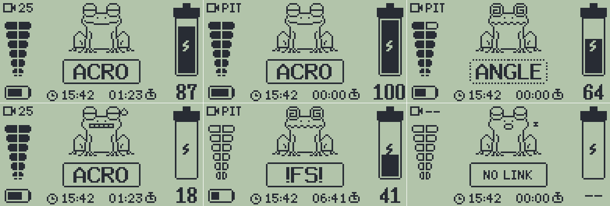

# EdgeTX FROG Telemetry Screen

A telemetry screen for EdgeTX radios with a 128×64 B&W display, for Betaflight quads over ELRS/CRSF. It shows:

- the VTX power (top left)
- the link quality (left: TQly, right: RQly)
- the drone battery and its voltage (right)
- a frog whose mood follows the flight, with the flight mode in a box below it
- the radio battery, the clock and the flight timer along the bottom



The frog sleeps without a link, gets dizzy in failsafe or while arming is blocked, glances anxiously at whatever
flashes (low batteries, a weak link) and hunts a fly while armed.

## Install

1. Copy `SCRIPTS/TELEMETRY/frog.lua` to the same path on the radio's SD card.
2. On the radio, go to Model → Telemetry → Screens, set a screen to *Script* and select `frog`.

Developed on a RadioMaster Pocket with EdgeTX 2.12.

## Development

Needs [uv](https://docs.astral.sh/uv/). The pixel art is drawn in Python in `art/`. `sim/` renders the script in a
reproduction of EdgeTX's B&W display and runs layout checks.

```sh
uv run build.py               # regenerate the sprites in frog.lua, render the previews and readme.webp, run the checks
uv run sim/render.py --help   # one-off renders of single states and frames, animation info
```

The fonts in `sim/fonts/` come from EdgeTX (GPL-2.0).
